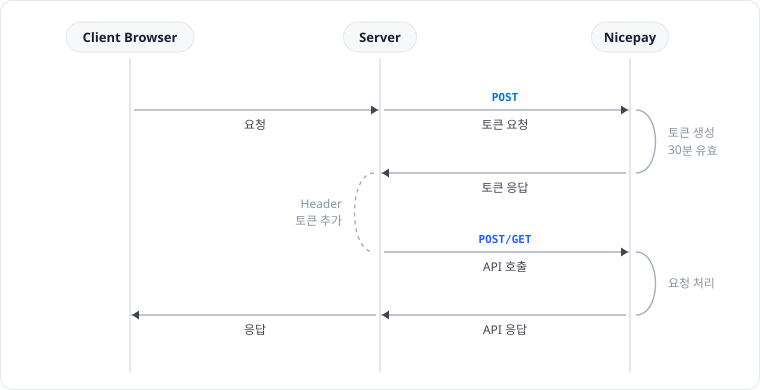

## Access token

### Over-view


### 활용
[Bearer token](../common/api.md#bearer-token)방식 authorization을 활용하여 API를 호출하는 경우 활용 합니다.

<br>

> #### ⚠️ 중요  
> [시크릿 키](../common/api.md#시크릿-키)를 [Basic auth](../common/api.md#basic-auth) 방식으로 생성한 경우 API 호출시 token 관리는 생략 할 수 있습니다.

<br>

### 샘플 코드
```bash
curl -X POST "https://api.nicepay.co.kr/v1/access-token" 
-H "Content-Type: application/json" 
-H "Authorization: Basic YWYwZDExNjIzNmRm..."
```

<br>

### 요청 명세 (Body)
```bash
POST /v1/access-token  
HTTP/1.1  
Host: api.nicepay.co.kr 
Authorization: Basic <credentials>
Content-type: application/json;charset=utf-8
```
|   Parameter  | type        |    필수    | byte |                             설명                           |
|:------------:|:-----------:|:----------:|:----:|:-----------------------------------------------------------| 
| returnCharSet|  String     |            |   10 | 응답 파라메터 인코딩 방식<br> 값: utf-8/euc-kr <br> Default:utf-8  |

<br>

### 응답 명세 (Body)
```bash
Content-type: application/json
```
|   Parameter  | type        |    필수    | byte |                             설명                           |
|:------------:|:-----------:|:----------:|:----:|:-----------------------------------------------------------| 
| resultCode  |  String     |     O      |   4  | 결과코드<br>0000: 성공/그외 실패  |
| resultMsg   |  String     |     O      |   100 | 결과 메시지 |
| accessToken |  String     |     O      |   40  | access token  |
| tokenType   |  String     |     O      |   10  | 인증 스킴 유형<br> Bearer 고정  |
| expiredAt   |  String     |     O      |       | Token 만료 시각<br>ISO 8601 형식  |
| now         |  String     |     O      |       | 현재 시각<br> ISO 8601 형식  |
  
[전체 문서 목록](../README.md)
