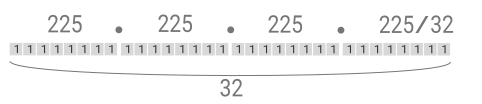
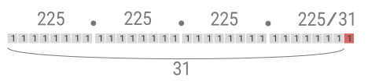

# 개발준비
[회원가입](#회원가입) | [API KEY 확인](#api-key-확인) | [방화벽 정책](#방화벽-정책) | [IP 보안기능](#ip-보안-기능) | [타임아웃 정보](#타임아웃-정보) | [더 알아보기](#더-알아보기)

<br>

## 회원가입
회원가입을 하고 🔧 [샌드박스](/common/test.md#샌드박스test)를 활용하면 빠르게 개발 할 수 있어요.  
[회원가입 페이지](https://start.nicepay.co.kr/merchant/login/main.do)로 이동 후 무료로 회원가입을 해보세요.  

- [회원가입](https://start.nicepay.co.kr/merchant/login/main.do)
- [샌드박스 준비](/common/test.md#샌드박스-준비)
- [샌드박스 활용](/common/test.md#샌드박스-활용)

<br>

## API KEY 확인
API KEY는 결제창과 API를 호출할 때 사용 됩니다.  
로그인을 하여 상점을 생성 후 [개발정보](/management/admin.md#개발정보)로 이동하면 API 🔑 KEY를 확인 할 수 있습니다. 

### API KEY
- [클라이언트 키](/common/api.md#클라이언트-키) : 결제창 호출시 활용 됩니다.
- [시크릿 키](/common/api.md#시크릿-키) : API 호출시 암호화 키 값으로 사용 됩니다.

### API · JS SDK 인증
- [JS SDK 인증](/common/api.md#js-sdk-인증)
- [Basic auth](/common/api.md#basic-auth)
- [Bearer token](/common/api.md#bearer-token)

<br>

> #### ⚠️ 중요  
> 샌드박스에서 제공되는 키와 운영상점에서 제공되는 키는 다릅니다.  
> 실제 운영상점의 결제를 원하는 경우 반드시 해당 상점 KEY로 변경 해주세요.   
> 운영상점의 시크릿 키가 외부에 노출되지 않도록 주의 해주세요.  
> 만약 노출된 경우 키를 변경하여 위험을 예방할 수 있습니다.  
> ( 로그인 > 개발정보 > 키 변경 )

<br>

## 방화벽 정책
원활한 통신을 위해 서버의 HTTP 클라이언트가 `TLS 1.2`에 대응되는지 확인 해주세요.  
서버에서 결제 API호출을 위해 필요한 서비스의 IP를 방화벽에서 허용 해주세요.  

| 서비스                | 도메인                       | 공인 IP Address                      | 방향       |
|--------------------|---------------------------|------------------------------------|----------|
| 결제창 연동 SDK (운영계)   | pay.nicepay.co.kr         | 121.133.126.85/27                  | OUTBOUND |
| 결제창 연동 SDK (샌드박스)  | sandbox-pay.nicepay.co.kr | 121.133.126.84/27                  | OUTBOUND |
| RESTful API (운영계)  | api.nicepay.co.kr         | 121.133.126.83/27                  | OUTBOUND |
| RESTful API (샌드박스) | sandbox-api.nicepay.co.kr | 121.133.126.84/27                  | OUTBOUND |
| 웹훅                 | -                         | 121.133.126.86 <br> 121.133.126.87 | INBOUND  |

<br>

## IP 보안 기능
나이스페이 API는 모든 IP 대역에서 호출이 가능 합니다.   
처음 상점을 생성한 후 IP 보안 기능을 통해 API 호출이 가능한 IP를 제어한다면 한 단계 높은 🔒 보안수준을 유지할 수 있습니다.  
IP 등록 규칙은 `CIDR`체계를 따르며 Class체계 대비 유연하게 IP 대역을 제한할 수 있습니다.  

### IP 보안 설정


- 로그인 후 [개발정보](/management/admin.md#개발정보)에 접속하면 IP 보안 등록이 가능 합니다.  
- 추가를 누른 후 설명과 `CIDR` 규칙을 입력 후 등록하면 등록된 IP대역만 API호출이 가능합니다.  

### CIDR 규칙과 등록
`network prefix / bit (0~32)` 범위 내에서 등록이 가능합니다.  
`CIDR` 대역이 넓은 경우 `CIDR` 계산기를 활용 하는 것을 권장 합니다.  

<br>

🔧 예시1  



```Bash
255.255.255.255 `1개` IP 범위를 CIDR 변환     
>> CIDR : 255.255.255.255/32  
```

<br>

🔧 예시2 



```Bash
255.255.255.254~255 `2개` IP 범위를 CIDR 변환  
>> CIDR : 255.255.255.255/31  
```

<br>

## 타임아웃 정보


HTTP 클라이언트 구성 시 타임아웃 예외 처리에 대한 정보 입니다.  
`Read-timeout`이 발생된 경우 반드시 [망 취소](/api/cancel.md#망취소)를 요청하여 결제 정보 불일치를 방지 해주세요.  

- Connection timeout : `5s`
- Receive(Read) timeout : `30s`  

<br>

    
## 더 알아보기
결제 개발을 위해 더 상세한 정보가 필요하다면📌 `공통` 탭의 정보를 활용하고,  
API 개발을 위한 각 인터페이스의 개발 명세가 필요하다면 📚 `문서` 탭의 자료를 확인 해주세요.  
개발이 완료되어 운영에 필요한 정보와 Tip은 ☸️ `운영` 탭의 정보를 통해 확인이 가능 합니다. 

### 📌 공통
개발 전 필요한 `공통`적인 가이드 입니다.  
- [개발 준비](/common/preparations.md) 👉 [회원가입](/common/preparations.md#회원가입) | [API KEY확인](/common/preparations.md#api-key-확인) | [방화벽 정책](common/preparations.md#방화벽-정책) | [IP 보안기능](/common/preparations.md#ip-보안-기능) | [타임아웃 정보](/common/preparations.md#타임아웃-정보)
- [API·JS SDK](/common/api.md) 👉 [URI 목록](/common/api.md#uri-목록) | [JS SDK목록](/common/api.md#js-sdk-목록) | [API KEY](/common/api.md#api-key) | [API·JS SDK인증](/common/api.md#apijs-sdk인증) | [Basic auth](/common/api.md#basic-auth) | [Bearer token](/common/api.md#bearer-token)
- [TEST·샘플코드](/common/test.md) 👉 [샌드박스 TEST](/common/test.md#샌드박스test) | [샌드박스 활용](/common/test.md#샌드박스-활용) | [웹로그 디버깅](/common/test.md#웹로그-디버깅) | [샘플코드](/common/test.md#샘플코드)
- [코드집](/common/code.md) 👉 [HTTP-상태코드](/common/code.md#http-상태코드) | [카드코드](/common/code.md#카드코드) | [은행코드](/common/code.md#은행코드) | [JS SDK 응답코드](/common/code.md#js-sdk-응답코드) | [API 응답코드](/common/code.md#api-응답코드)
  
### 📚 문서
`API 명세`와 `코드`가 포함된 기술문서 입니다.  
- [결제·발급](/api/payment.md#) 👉 [결제창](/api/payment-window-server.md) | [현금영수증](/api/payment-receipt.md) | [Access token](/api/payment-access-token.md)
- [조회](/api/status.md) 👉 [거래 조회](/api/status-transaction.md) | [약관 조회](/api/status-terms.md) | [카드 이벤트 조회](/api/status-event.md) | [카드 무이자 조회](/api/status-interest.md)
- [취소·환불·망취소](/api/cancel.md) 👉  [취소·환불](/api/cancel.md#취소환불) | [망 취소](/api/cancel.md#망취소)
- [웹훅](/api/hook.md) 👉 [웹훅](/api/hook.md#웹훅)
- [APP](/api/app.md) 👉 [iOS](/api/app-ios.md#ios) | [iOS Swift](/api/app-ios.md#ios-swift-웹뷰web-view개발-가이드) | [iOS Objective-c](/api/app-ios.md#ios-objective-c-웹뷰web-view개발-가이드) | [Android](/api/app-android.md#) | [Android java](/api/app-android.md#android-java-웹뷰web-view개발-가이드) | [Android kotlin](/api/app-android.md#android-kotlin-웹뷰web-view개발-가이드)

### ☸️ 운영
`운영`에 필요한 정보 입니다.  
- [지원환경](/management/user.md) 👉 [개발환경](/management/user.md#개발환경) | [지원 브라우저](/management/user.md#브라우저)
- [오류관리](/management/user.md#오류관리) 👉 [오류관리](/management/user.md#오류관리)
- [개발정보](/management/admin.md) 👉 [기능 요약](/management/admin.md#기능-요약) | [KEY 정보](/management/admin.md#key정보) | [ip보안(ip접근제한)](/management/admin.md#ip보안ip접근-제한) | [웹훅](/management/admin.md#웹훅) | [로그](/management/admin.md#로그)
